# Harness анатомического разбора объёма перед разметкой одного среза

**Обновление 25.10.2026:** пользователь отдельно разрешил просмотр обезличенных CT-кадров в контексте облачной модели. После этого выполнен выборочный визуальный разбор, сохранён журнал и создан отдельный пятиструктурный кандидат одного среза. Текущий результат: [ANATOMY_VISUAL_SLICE_REVIEW.md](ANATOMY_VISUAL_SLICE_REVIEW.md). Описанные ниже отсутствие исполнителя и нулевые журналы относятся к предшествующему этапу local-only и сохранены как история, а не актуальный запрет пользователя.

25.10.2026. Предыдущий `single_slice_assist` не выполнил намерение пользователя: он объединял вероятности и уточнял границы, а не устанавливал анатомию по объёму. Его файлы сохранены как прежний вычислительный эксперимент. Новый путь начинается с исходного CT без масок и ведёт журнал визуальных свидетельств.

**Исходное состояние C-001 до нового разрешения:** harness реализован, локальный контекст подготовлен, но анатомический разбор пациента и новая анатомически обоснованная разметка **не выполнены**. На том этапе пользователь сохранил полностью локальный режим. Облачная модель не просматривала CT; проверенный локальный визуальный исполнитель не обнаружен. Автоматически сгенерированных анатомических заметок не было. Отсутствие исполнителя не подменялось вероятностями, morphology cleanup или придумыванием описаний.

## Процесс

```mermaid
flowchart LR
    A[Исходный HU CT + проверка геометрии] --> B[Обзор AX / COR / SAG без AI overlay]
    B --> C[Наблюдаемые признаки + отдельные гипотезы]
    C --> D[Соседние срезы + ход структур + противоречия]
    D --> E[Выбор целевой плоскости после обзора]
    E --> F[Обоснование каждой метки и границы]
    F --> G[Кандидатная разметка одного среза]
    G --> H[Bundle: mask + immutable notebook + hashes]
    H --> I[Проверка врачом]
```



Сначала фиксируется то, что видно; затем — гипотеза о принадлежности. При пороках морфология, положение и соединения могут расходиться, поэтому название камеры не устанавливается одной стороной изображения. [Последовательный сегментарный анализ](https://pmc.ncbi.nlm.nih.gov/articles/PMC6301191/)

Проверочные признаки включают трабекулярность/выходные отделы желудочков, венозные и клапанные связи предсердий, прослеживание корня/восходящего пути AO и ствола/ветвей PA. Неуверенные границы и послеоперационные изменения остаются вопросами для проверки. [ASCI CT guideline](https://www.kjronline.org/DOIx.php?id=10.3348/kjr.2020.1332) Это общая инструкция, не вывод о C-001. Точные source conventions CHD68 для MYO, колец и пределов сосудов всё ещё не подтверждены.

## Что хранит журнал

В существующем приложении появилась кнопка **«Анатомический разбор CT»**. Она открывает CT-only и скрывает маски/контуры для сбора исходных свидетельств. Наблюдения разрешены по всему объёму и не ограничены scope прежнего односрезового черновика.

- Observation: источник human/local_model, видимый признак, неизвестная или предполагаемая структура, признаки, уверенность, причина неопределённости, окно/уровень, точка и нормаль плоскости в LPS, anchor IJK, CT hash. Якорь — центр сохранённого вида; при необходимости сначала сместить интересующую область в центр окна.
- Hypothesis: отдельная запись со ссылками на CT observations. Предсказание, mask contour и probability map не могут выступать evidence ID.
- Track: наблюдения вдоль структуры и явные continuation / branch / unresolved links. Пропуск не объявляется доказанной непрерывностью.
- Target decision: состояние каждого из семи классов, поддержка/противоречия, tracks, boundary rule, rationale и нерешённые вопросы. Состояния `not_visible` и `not_assessable` различаются.

К записи можно вернуться в физическую MPR-плоскость с её окном. Для oblique CT точка/нормаль остаются основным описанием: округлённый native index записывается только при реальном совмещении с сеткой.

Записи версионируются отдельно от segmentation head и masks в новой append-only таблице `AnatomyNotebookVersion`. Исходные таблицы не изменяются. Есть CT hash, optimistic concurrency, server author/time, защита от UPDATE/DELETE, авторизация по назначению, CSRF и JSON export конкретной версии с hashes. Незавершённая форма не публикуется автоматически; переходы блокируются до «Добавить»/«Записать» или явной отмены.

`readiness.ready` означает только полноту документации. Для `delineated` требуется поддержка как минимум в двух видах, физически непараллельные нормали плоскостей (`abs(dot) < 0.95`) и continuation на **двух соседних native planes одного вида/оси**, плюс правило границы и обоснование. Два разных ракурса сами по себе не заменяют прослеживания соседних срезов. Непрерывность для oblique-only записей пока не проходит этот автоматический completeness gate; это ограничение реализации, не медицинский вывод. `expert_validated` и `ready_factual` остаются false. Локальные model proposals сохраняют свой источник и требуют внешней проверки.

## Локальные context packets

`heart3d/anatomy_harness.py` создаёт raw-CT кадры с физически согласованным aspect ratio, безопасными сгенерированными ориентационными маркерами и преобразованием PNG pixel centre → IJK. HU не заменяются intensity range CHD68: окна используются только для отображения. Оригинальный CT не меняется.

Для C-001 подготовлены **80** обзорных/соседних кадров в двух отображающих окнах, только на диске:

`C:/Users/Andre/Desktop/3D-heart/private_clinical/anatomy_context_C001_20261025/`

В `packet_manifest.private.json` каждый кадр имеет hash, физический locator и статус `not_reviewed`. Наличие пакета не является просмотром. Доступен весь исходный объём; обзорная выборка не объявляется полным просмотром 363 AX-плоскостей и всех COR/SAG. Срез Z=146 включён лишь как прежний **hint**, а не как анатомически выбранная новая цель. `review_log.json` и `observer_status.json` явно содержат 0 наблюдений, 0 просмотренных packets и отсутствие новой разметки.

Пример подготовки из корня `repository`:

```powershell
.\.venv\Scripts\python.exe -m heart3d.anatomy_harness prepare `
  --ct <проверенный_clean_CT.nii.gz> --admission <admission.json> `
  --protocol configs/anatomy_review_protocol_v1.json --out <новый_private_folder>
```

`request-packets` дополнительно принимает `--request <local_request.json>` с source indices и window presets. Он проверяет CT hash, bounds и допустимые поля, не принимает URLs, не выполняет команды из ответа модели и создаёт новый output. Обозначение AX/COR/SAG при offline packet export сейчас требует axis-aligned XYZ; oblique MPR используется через веб-журнал с физическими координатами.

## Связь журнала с маской

`heart3d/anatomy_bundle.py` выполняет финальный bind, а не рисует структуру:

```powershell
.\.venv\Scripts\python.exe -m heart3d.anatomy_bundle assemble `
  --ct <clean_CT.nii.gz> --admission <admission.json> `
  --notebook <immutable_notebook_export.json> --mask <candidate.nii.gz> `
  --out <новый_private_bundle>
```

Проверяются hashes notebook export/document/CT, schema, completeness, original-grid shape/affine/qform/sform/mm/uint8 и одна целевая AX-плоскость. Положительная метка должна иметь соответствующее `delineated` решение с CT evidence. Необоснованные или отсутствующие классы не дорисовываются. Маска и notebook копируются побайтно, manifest связывает их hashes и scope. `expert_approved:false`; успех команды не делает результат правильным с медицинской точки зрения. Для C-001 такой bundle не собирался: необходимых наблюдений и новой обоснованной маски нет.

## Локальный визуальный исполнитель

Проверены команды ollama/lms/llama-server/llama-cli, endpoints 127.0.0.1:11434 и :1234 и известные каталоги Ollama/LM Studio. Исполнитель/модели там не найдены. Это проверка перечисленных мест, а не сканирование всех файлов компьютера. Новые веса/runtime не устанавливались и не скачивались.

`localhost` сам по себе недостаточен: локальный Ollama способен перенаправлять вызовы remote model; официальный FAQ предусматривает отключение cloud. [Ollama FAQ](https://docs.ollama.com/faq#how-do-i-disable-ollamas-cloud-features), [официальный server source](https://github.com/ollama/ollama/blob/main/server/routes.go). Для принадлежащего оператору llama.cpp предусмотрены локальные model/projector и offline-режим. [Multimodal docs](https://github.com/ggml-org/llama.cpp/blob/master/docs/multimodal.md)

Перед любым будущим использованием нужны контролируемый runtime, конкретные локальные weights/projector hashes, vision capability, отключённый relay, проверенная process-level network isolation и отдельная проверка клинической применимости. `check-runtime --receipt <json>` проверяет поля/локальные hashes receipt; операторские attestations не являются независимым аудитом. **Исполнение image inference в этом preflight не включено**, сети/отправки images в модуле нет. Browser guard защищает browser context, но не удостоверяет отсутствие relay в постороннем локальном сервере. Небольшая generic VLM не объявляется анатомическим экспертом только из-за того, что она запускается на 6 GB.

Подробная инструкция для человека/будущего локального исполнителя: [ANATOMY_OBSERVER_INSTRUCTIONS.md](ANATOMY_OBSERVER_INSTRUCTIONS.md). Она требует адаптивного запроса соседних срезов и накопления заметок, а не однократного ответа по одному PNG.

## Запуск и фактический предел результата

```powershell
.\scripts\Start-Annotation.ps1 -IsolatedBrowser -AnatomyReview
```

Затем открыть C-001. `?view=anatomy` начинает с CT-only и журнала. Сохранение записей не вызывает raster preview и не меняет прежние маски/head/status. Экспорты notebook и локальной конфликтной копии сохраняются в private web-data exports; внешние download URLs блокируются. Данные и контекстные изображения не публиковались, клинические изображения облачная модель не читала.

**Сделан инструмент и проверяемая схема работы, но не выполнен новый анатомический разбор пациента.** Продолжить такой разбор в выбранном полностью локальном режиме может человек в приложении либо отдельно выбранный, установленный и проверенный локальный визуальный исполнитель. До этого журнал должен оставаться пустым/неполным, а новая анатомическая разметка — отсутствовать.

## Проверки реализации

Финальная проверка 25.10.2026:

| Проверка | Результат |
|---|---|
| Python: anatomy review / harness / bundle, predictions / partial draft / annotation | 92 passed; только синтетические изображения и notebooks |
| Browser E2E: anatomy-review / annotation / predictions / single-slice | 4 passed, 1.5 min; отдельные synthetic servers |
| Frontend production build | Успешно; остаётся предупреждение о размере bundle |
| C-001 read-only UI smoke test | Три MPR видны, по 230 уровней серого в числовой выборке, цветных overlay pixels нет; AX/COR/SAG capture и вкладки доступны |
| Изменения в C-001 при smoke test | 0 notebook writes, 0 segmentation edits, 0 mask/preview requests; существующие head/status/revision и notebook version сохранены |
| Browser network guard smoke test | 0 завершённых внешних запросов; 1 внешняя попытка заблокирована. Это проверка данного browser context, не аудит всей сети ОС |
| CT / исходные predictions v1/v2 / checkpoints v1/v2 | Все пять SHA-256 совпали с ранее зафиксированными |
| Передача клинических pixels в контекст облачной модели | Не выполнялась; screenshots/traces при реальной проверке выключены |

Read-only проверка выполнена `web/scripts/check-anatomy-viewer.mjs`: pixels сводятся внутри Chrome к числам. Пустые формы capture открыты и отменены; это техническая проверка locator/UI, **не анатомическое наблюдение**. Приватный результат — `web_harness_verified.json` рядом с packets. В интерфейсе C-001 открыт в CT-only режиме с журналом; пользователь может вести собственные наблюдения.

В ходе synthetic проверки исправлено прежнее округление continuous IJK при сохранении физической MPR-плоскости: locator использует `imageData.worldToIndex`, а не helper с округлением. Также E2E contour tracing ожидает ответ самой операции, вместо прежнего короткого ожидания UI. Эти изменения не являются исправлением анатомии пациента.

Логи проверок остаются в игнорируемом `outputs/`. Доступны предупреждения устаревающих API httpx/TestClient и NumPy/skimage; они не изменили результат проверок. Обучение, новые inference на пациенте, установка VLM и публикация не выполнялись.
