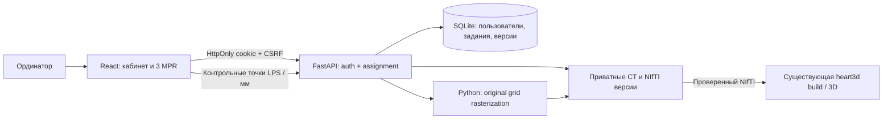

# Heart3D Annotation: архитектура локального MVP

Обновление 23.10.2026: исходное описание ниже фиксирует синтетический MVP. Контролируемый clinical import, AI-версии, отдельный surgeon-approved reference и изолированный локальный браузер добавлены в следующем этапе; текущие результаты и границы допуска описаны в [FIRST_CLINICAL_CT_INFERENCE.md](FIRST_CLINICAL_CT_INFERENCE.md). Это не общий допуск всего клинического набора.

Дата: 22–23.10.2026. Область: ручная экспертная разметка **синтетического** CT. Клинические DICOM, фотографии заключений и восстановленные ML checkpoint в этот стенд не загружались. Обучение и inference моделей не запускались.

## Выбор компонентов

| Компонент | Решение и причина |
| --- | --- |
| React + TypeScript | Кабинет и редактор, типизированные DTO; состояние авторизации только в памяти и серверной cookie. |
| Cornerstone3D 5.13.1 | Готовые orthographic MPR, физические world/canvas преобразования, hit testing точек, scroll, zoom, pan, W/L, labelmap и BrushTool. |
| SplineROITool, LINEAR | Полигон с контрольными точками: замыкание, перетаскивание, Shift-добавление, Ctrl-удаление. Прямые отрезки однозначно воспроизводятся Python-растеризацией. |
| FastAPI + SQLAlchemy + SQLite WAL | Один локальный стенд и один рабочий ординатор; проверки полномочий, журнал, транзакции, optimistic concurrency. Отдельные сущности позволяют позднее перейти на PostgreSQL. |
| NumPy/nibabel/scikit-image | Проверка исходной сетки и каноническая растеризация; используются существующие `image_geometry`, `LPS_TO_RAS`, `sha256_file`, схема `LABELS`. |
| Приватный каталог | CT и неизменяемые версии NIfTI вне frontend/public; API отдаёт только назначенное исследование после проверки сессии. |

Cornerstone лицензирован MIT ([лицензия](https://raw.githubusercontent.com/cornerstonejs/cornerstone3D/main/LICENSE)). API и фактический код установленной версии проверены; [SplineROITool](https://www.cornerstonejs.org/docs/api/tools/classes/splineroitool/) уже содержит нужные действия с точками. Весь медицинский JS-редактор заново не реализуется.

Рассмотрены альтернативы:

- [OHIF](https://docs.ohif.org/) — готовая расширяемая платформа просмотра, [MIT](https://raw.githubusercontent.com/OHIF/Viewers/master/LICENSE). Для первого сценария добавляет DICOMweb/режимы/расширения; оставлен возможным будущим интеграционным уровнем.
- [vtk.js](https://kitware.github.io/vtk-js/docs/) — низкоуровневая визуализация, [BSD-3-Clause](https://raw.githubusercontent.com/Kitware/vtk-js/master/LICENSE), уже используется Cornerstone. Самостоятельная сборка редактирования поверх него увеличила бы объём геометрического кода.
- [3D Slicer Segment Editor](https://slicer.readthedocs.io/en/latest/user_guide/modules/segmenteditor.html) — сильный настольный инструмент для независимой проверки NIfTI; [собственная лицензия BSD-style](https://raw.githubusercontent.com/Slicer/Slicer/main/License.txt), условия расширений проверяются отдельно. Веб-кабинет поверх Slicer сейчас не создаётся.

React/FastAPI — MIT. Прямые версии и транзитивные зависимости frontend зафиксированы в `web/package-lock.json`; Python web-зависимости отделены в `requirements-web.txt` и `requirements-web-lock.txt`. При распространении сборки необходимо сохранить notices всех зависимостей, включая MIT и vtk.js BSD; ссылки не заменяют комплект лицензий дистрибутива. MVP локальный, публикация не выполнялась.

## Поток данных и геометрия

NIfTI affine хранится в RAS, Cornerstone работает в LPS. Адаптер использует существующее `LPS_TO_RAS`; direction передаётся столбцами, scalar layout — x-fastest, NumPy `order='F'`. Spacing и origin берутся из проверенного affine. Sheared grids отвергаются. Произвольные oblique-серии не объявлены валидированными этим MVP: браузерный сквозной тест выполнен на ортогональном синтетическом RAS CT.

У `createLocalVolume` 5.13.1 проверено поведение image-backed slices: исходный origin повторяется для всех локальных кадров. Адаптер заполняет imagePositionPatient каждого кадра штатным `vtkImageData.indexToWorld([0,0,k])`. Иначе инструменты не находят правильный referenced image.

Контур хранит UUID, label, axis, slice, список LPS точек, closed/applied. На сервер не передаются экземпляры spline и screen coordinates. Python проверяет конечность координат, класс, диапазоны и соответствие плоскости исходной сетки с допуском 0.05 voxel. При растеризации численная погрешность affine около целых координат устраняется только при отклонении менее 1e-6 voxel; реальные субвоксельные вершины сохраняются.

Маска пересчитывается из упорядоченных операций с нуля. Операция контура ссылается на его текущие контрольные точки; изменение или удаление не оставляет старый отпечаток. Нативная кисть/ластик Cornerstone передаёт sparse voxel patch (index/value), который сервер валидирует. Более поздние операции имеют приоритет в перекрытиях. После редактирования раннего контура более поздний brush patch сохраняет свой приоритет. Интерполяция между срезами, отверстия и автоматическое сглаживание отсутствуют.

Перед выдачей CT проверяется SHA-256. Сохранение создаёт отдельный uint8 NIfTI, сохраняет shape, affine, qform/sform, mm; затем файл перечитывается и проверяется. Экспорт и загрузка сохранённой маски проверяют hash. Исходный CT не перезаписывается.

## Сущности и жизненный цикл

В `heart3d/web/db.py` определены User, Role, Patient, Study, Series, Assignment, AnnotationProject, AnnotationVersion, AnnotationOperation, Review, Approval, Session, AuditEvent.

- Patient/Study имеют только псевдонимы; Series содержит приватный относительный путь, hash и grid CT.
- Assignment ограничивает resident и surgeon конкретными проектами; admin имеет полный доступ. Скрытие кнопки не считается авторизацией: проверки выполняются на каждом проектном endpoint, включая volume, mask, preview, save, versions, export, submit и review.
- Версия содержит parent, номер, author, UTC time, CT hash, label schema, source=`manual`, документ, mask path/hash, geometry_verified. Все снимки append-only через API; endpoints изменения и удаления версий отсутствуют.
- Review хранит решение хирурга и комментарий; Approval привязан к конкретной версии. Проверяющий должен быть назначенным surgeon; resident не может утверждать.

Переходы: `not_started → in_progress → submitted → approved` либо `submitted → needs_revision → in_progress`. В submitted/approved редактирование закрыто. Утверждение не изменяет содержимое версии. Полноценного интерфейса хирурга пока нет; API переходов покрыт тестом.

Сохранение отправляет `base_version_id`, CT hash и label schema. Устаревший head или параллельная запись получает 409; клиент оставляет несохранённый документ открытым. Проверка revision/status в SQL предотвращает перезапись более новой разметки. Два параллельных изменения автоматически не объединяются. При аварии между записью файла и commit возможен непривязанный каталог версии; он не заменяет существующие данные и требует будущей уборки по сверке с БД.

## Сохранение в редакторе

Замкнутые контуры и brush patches сохраняются автоматически после 2.2 секунд без изменений, также есть ручное сохранение. Записи сериализованы на клиенте. Undo/redo держит до 40 снимков документа в памяти; после повторного входа история undo начинается заново, сами точки и маски восстановлены с сервера. Выбранное исследование отражено в URL и открывается после reload с проверкой доступа.

При выходе/возврате в кабинет сначала сохраняется черновик. При ошибке редактор остаётся открытым. `beforeunload` предупреждает о несохранённых изменениях, активной записи и незавершённом контуре. Незамкнутый native-контур на сервер не записывается: его следует замкнуть или отменить Esc. Последние 2.2 секунды работы при аварийном завершении браузера могут быть потеряны. IndexedDB/offline recovery намеренно не добавлен, чтобы не создавать ещё одну неуправляемую копию медицинских данных.

## Безопасность локального стенда

Argon2id, минимум 12 символов при создании пароля. Учётные записи создаются владельцем ОС через CLI; открытой регистрации и стандартного пароля нет. В БД хранится hash пароля и SHA-256 случайного session token. Cookie HttpOnly, SameSite=Strict, Path=/api, срок 8 часов; logout удаляет серверную сессию. CSRF token хранится только в памяти frontend и отправляется заголовком. На изменяющих запросах проверяется Origin; список CORS точный. Ошибки логина общие, после 20 неудач за 5 минут включается локальное ограничение. Перед многопользовательским пилотом нужен более точный per-account/per-source limiter.

Статическое хранилище CT не смонтировано. Ссылки и UUID не заменяют проверку Assignment. API задаёт no-store, nosniff, no-referrer и запрет iframe. Frontend не содержит telemetry, удалённых fonts, CDN, внешнего inference или отправки CT третьим лицам. CSP ограничивает источники текущим origin; dev исключение unsafe-inline нужно React refresh, в HTTPS-шаблоне script-src строже.

AuditEvent пишет actor UUID, action, project UUID и UTC time, без имени пациента, содержимого CT, паролей и cookie. Uvicorn запускается с `--no-access-log`. Журналы инфраструктуры, дампы и browser traces должны рассматриваться как приватные; Playwright использует исключительно синтетические объёмы и тестовые аккаунты.

`.web-data`, outputs, SQLite, CT/NIfTI и node_modules исключены из Git. ОС-владелец имеет доступ к БД и файлам: это не WORM-хранилище и не защита от привилегированного администратора. Перед пилотом нужны ACL выделенного сервисного пользователя, шифрование диска/резервных копий, управление ключами и независимый аудит.

## Будущий HTTPS

`deploy/Caddyfile.annotation.example` задаёт reverse proxy `/api`, CSP и отдельный root **только web/dist**. По умолчанию bind остаётся loopback; `tls internal` требует доверия к внутреннему CA на клиентских устройствах. Проверка сертификатов и реальное удалённое подключение в этом MVP не выполнены; Caddy не установлен и firewall не открыт. Семантика конфигурации основана на [официальном TLS API Caddy](https://caddyserver.com/docs/caddyfile/directives/tls).

Для контролируемого пилота: согласовать hostname/certificate chain, VPN/закрытую сеть, заменить loopback на утверждённый private interface, установить доверенный сертификат, задать `HEART3D_COOKIE_SECURE=1`, `HEART3D_ALLOWED_ORIGINS=https://<approved-host>`, проверить Secure cookie и запрет прямого доступа к backend. Dev Vite публично не выставлять. Сам шаблон не означает готовность безопасного удалённого развёртывания.

## Деидентификация и допуск клинических данных

Приём клинических файлов через этот MVP отсутствует. Перед его добавлением нужен отдельный проверяемый конвейер, а не только удаление PatientName:

1. Документировать владельца данных, цель, круг пользователей и разрешённые исследования. Исходники держать в отдельном защищённом контуре; создавать новую производную копию.
2. Выбрать применимые profile/options [DICOM PS3.15 Annex E](https://dicom.nema.org/medical/dicom/current/output/chtml/part15/chapter_E.html); обработать стандартные/private tags, free text, UID references, overlays, secondary captures и сопроводительные файлы. Сохранять согласованность геометрии и ссылок; таблицу соответствия псевдонимов держать отдельно.
3. Проверить пиксели на burned-in identifiers: автоматическая проверка плюс визуальная экспертиза всех серий/типов представления. BurnedInAnnotation=NO само по себе не является доказательством. Очистка атрибутов не гарантирует деидентификацию всего объекта — это прямо оговорено стандартом.
4. Независимо проверить результат: отсутствие идентификаторов в headers, пикселях, именах файлов, NIfTI extensions и производных изображениях; контроль hash, числа кадров и неизменности пространственной сетки.
5. Утвердить правовые основания и согласия/полномочия в отношении несовершеннолетних, применимую юрисдикцию, сроки/место хранения, права субъектов, доступ, удаление и реагирование на инциденты вместе с учреждением и ответственным за данные. В исходном задании нет сведений, позволяющих установить эти основания; правовой допуск **не подтверждён**.

Это план допуска, а не утверждение нормативного соответствия или реализованный DICOM deidentifier.

## Резервная копия и восстановление

CLI `backup --out <new-dir>` создаёт согласованный snapshot SQLite через backup API, затем копирует immutable raw/annotations и SHA-256 manifest. Сначала фиксируется БД: новые файлы, появившиеся позднее, не нужны этому snapshot. Новый destination обязателен; существующий не перезаписывается.

Восстановление: остановить backend, сверить каждый относительный путь и SHA-256 с `backup_manifest.json`, скопировать snapshot в отдельный защищённый каталог, выставить `HEART3D_WEB_DATA` на него и запустить приложение. Относительные пути переносимы. Выполнить вход, открыть последний head и экспортировать mask; сравнить hash/grid. Интеграционный тест действительно открывает приложение из backup в другом root. Перед пилотом дополнить расписанием, шифрованием, изолированным хранением, RPO/RTO и регулярной учебной реставрацией.
